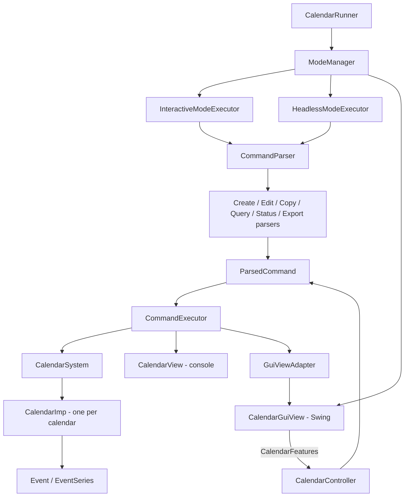

# Calendar Management System

A multi-calendar desktop application in Java with three ways to use it: a **Swing GUI**, an **interactive command line**, and a **headless script runner**. All three are built on one Model–View–Controller core.


- **Language / build:** Java 11, Gradle (wrapper included)
- **Runtime dependencies:** none, JDK only
- **Quality gates:** JUnit 4 tests, JaCoCo coverage, PIT mutation testing, Checkstyle

---

## Run the demo

**Requirements:** JDK 11+ on your `PATH`. No separate Gradle install is needed. Use the bundled wrapper (`./gradlew` on macOS/Linux, `gradlew.bat` on Windows).

```bash
git clone https://github.com/arshmehar/Calendar-Management-System.git
cd Calendar-Management-System
./gradlew jar                                   # builds build/libs/calendar-1.0.jar
java -jar build/libs/calendar-1.0.jar           # launches the GUI
```

The other two modes:

```bash
java -jar build/libs/calendar-1.0.jar --mode interactive             # type commands one at a time
java -jar build/libs/calendar-1.0.jar --mode headless commands.txt   # run a script file
```

`--mode` is case-insensitive, and a headless script must end with `exit`. [`commands.txt`](commands.txt) is a ready-made script that creates calendars in two timezones, builds recurring series, edits and copies events, checks availability, and exports to iCal.

---

## Highlights

- **Three front-ends, one core.** The GUI, the REPL, and the script runner all produce the same `ParsedCommand` objects and go through the same `CommandExecutor`, so every feature is written once and works everywhere.
- **Timezone-aware calendars.** Each calendar has an IANA timezone. Copying events between calendars converts times correctly, and changing a calendar's timezone moves its events with it.
- **Real recurring-event semantics.** Series repeat on chosen weekdays for *N* times or until a date, and edits can target one occurrence, this-and-future, or the whole series. Changing a start time splits the series where it should.
- **Interoperable export.** CSV in Google Calendar's import format, plus iCal. The export has been checked by importing it into Google Calendar ([screenshot](res/GoogleCalendarScreenShot.PNG)).
- **Tested without the UI.** Controller tests run against hand-written mocks of the model and views, so the logic is tested without starting Swing.

---

## Features

| Area | What you can do |
|---|---|
| **Calendars** | Create multiple calendars, each with a unique name and timezone; rename a calendar or change its timezone; switch between calendars |
| **Events** | Timed, all-day, and multi-day events with subject, location, description, and public/private status |
| **Recurring series** | Repeat on any weekdays (`MTWRFSU`) for *N* occurrences or until an end date, for timed or all-day events |
| **Editing** | Edit subject, start, end, location, description, or status for a single event, this and future events, or an entire series |
| **Copying** | Copy one event, all events on a day, or all events in a date range into another calendar, with timezone conversion |
| **Queries** | List events on a day or in a time range; check busy/available status at a given moment |
| **Export** | `.csv` (Google Calendar format) and `.ical` |
| **Interfaces** | Swing GUI with month view, interactive REPL, headless script mode |

---

## User Interface

<table>
  <tr>
    <td align="center"><br><sub>Month view with the selected day's events</sub></td>
    <td align="center"><br><sub>New calendar with a timezone</sub></td>
  </tr>
  <tr>
    <td align="center"><br><sub>Create a single event</sub></td>
    <td align="center"><br><sub>Create a recurring series</sub></td>
  </tr>
  <tr>
    <td align="center"><br><sub>Edit one event, this and future, or the whole series</sub></td>
    <td align="center"><br><sub>Rename a calendar or change its timezone</sub></td>
  </tr>
</table>

A step-by-step GUI walkthrough is in [`USEME.md`](USEME.md).

---

## Architecture



**How a command flows:** text input is split by `CommandParser` into a family-specific parser (create, edit, copy, query, status, export). That parser validates the syntax and builds an immutable `ParsedCommand`. In the GUI, `CalendarController` builds the same `ParsedCommand` from dialog fields. `CommandExecutor` then dispatches it to the model and sends the result to whichever view is active.

### Design patterns

| Pattern | Where | Why |
|---|---|---|
| **MVC** | `model/`, `view/`, `controller/` | The model knows nothing about input or display, which is what let a GUI be added without touching it |
| **Adapter** | `GuiViewAdapter` | Lets the executor, written for console output, drive Swing popups and panel refreshes through the same `IcalendarView` interface |
| **Command** | `ParsedCommand` + `CommandExecutor` | Each request is a value object, decoupling how a command is entered from how it runs |
| **Builder** | `ParsedCommand.Builder` | Commands have many optional fields (location, repeat rule, target calendar) |
| **Strategy** | `ImodeExecutor` → interactive / headless | The input source is swapped without changing the execution logic |

### SOLID in practice

- **Single responsibility:** parsing is split into one parser per command family instead of one large parser.
- **Open/closed:** `CommandExecutor` dispatches through a `Map<CommandType, Consumer<ParsedCommand>>`, so a new command adds an entry instead of editing a `switch`.
- **Interface segregation:** GUI actions live in `CalendarFeatures`, separate from the controller lifecycle in `IcalendarController`.
- **Dependency inversion:** controllers and views depend on `IcalendarSystem`, `IcalendarView`, and `IcalendarGuiView`, not on concrete classes. That is also what makes the mock-based tests possible.

The full class diagram is in [`res/ClassDiagram.png`](res/ClassDiagram.png), and the design changes made for the GUI iteration are written up in [`res/Misc.md`](res/Misc.md).

---

## Command reference

Dates use `YYYY-MM-DD` and date-times use `YYYY-MM-DDThh:mm`. Subjects with spaces go in quotes.

### Calendars
```text
create calendar --name <name> --timezone <area/location>
edit calendar --name <name> --property name <newName>
edit calendar --name <name> --property timezone <area/location>
use calendar --name <name>
```

### Events
```text
create event <subject> from <dateTime> to <dateTime>
create event <subject> on <date>                                         # all-day

create event <subject> from <dateTime> to <dateTime> repeats <weekdays> for <N> times
create event <subject> from <dateTime> to <dateTime> repeats <weekdays> until <date>
create event <subject> on <date> repeats <weekdays> for <N> times        # all-day series
```

Weekday codes: `M` Mon · `T` Tue · `W` Wed · `R` Thu · `F` Fri · `S` Sat · `U` Sun

### Editing
```text
edit event  <property> <subject> from <dateTime> to <dateTime> with <value>   # one occurrence
edit events <property> <subject> from <dateTime> with <value>                 # this and future
edit series <property> <subject> from <dateTime> with <value>                 # whole series
```
`<property>` is one of `subject`, `start`, `end`, `location`, `description`, `status`.

### Copying
```text
copy event <subject> on <dateTime> --target <calendar> to <dateTime>
copy events on <date> --target <calendar> to <date>
copy events between <date> and <date> --target <calendar> to <date>
```

### Queries and export
```text
print events on <date>
print events from <dateTime> to <dateTime>
show status on <dateTime>                 # busy or available
export cal <fileName>.csv | <fileName>.ical
```

Example invalid inputs and the errors they produce are in [`res/invalid.txt`](res/invalid.txt).

---

## Testing & quality

```bash
./gradlew test             # 312 JUnit tests; JaCoCo report in build/reports/jacoco
./gradlew pitest           # PIT mutation testing (slower)
./gradlew checkstyleMain   # style check against config/checkstyle/checkstyle.xml
```

- **Model tests** cover calendar and event rules: duplicate calendars, invalid timezones, series splitting, and timezone changes, including events that cross midnight.
- **Controller tests** run text commands and GUI actions against mocks (`src/test/java/mocks`) and assert on what was sent to the model and view.
- **Mutation testing** with PIT checks that the tests actually catch changed behaviour, not just execute lines.

---

## Project structure

```
src/main/java/
├── CalendarRunner.java            # entry point, picks the mode from args
├── controller/                    # parsers, CommandExecutor, mode executors, CSV/iCal exporters
│   └── features/CalendarFeatures  # actions the GUI can trigger
├── model/                         # CalendarSystem, CalendarImp, Event, EventSeries, exceptions
└── view/
    ├── CalendarView.java          # console view
    └── gui/                       # Swing view, dialogs, event panels, adapter
src/test/java/                     # JUnit tests + mocks for model, view and controller
res/                               # screenshots, class diagram, design notes, example commands
```

---

## Documentation

- [`USEME.md`](USEME.md): how to run each mode and use every GUI feature, with screenshots
- [`res/Misc.md`](res/Misc.md): design changes made to support the GUI
- [`res/ClassDiagram.png`](res/ClassDiagram.png): full UML class diagram

---

## Team

Built as a pair project for **CS5010: Programming Design Paradigm** at Northeastern University by [arshmehar](https://github.com/arshmehar) and [adikejre](https://github.com/adikejre).

**My contributions (arshmehar):** the GUI's edit-calendar flow (rename and change timezone), showing the active calendar's timezone in the GUI, error handling for invalid calendar renames, GUI controller tests, and the project-wide Checkstyle compliance pass.
