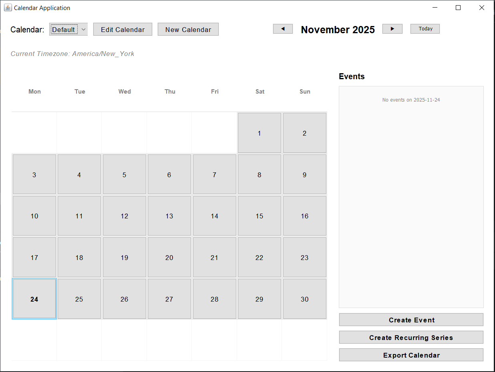
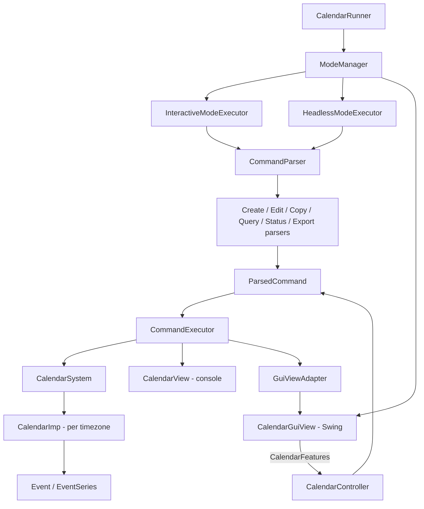

# Calendar Management System

A multi-calendar desktop application in Java with three ways to use it: a Swing GUI, an interactive command line, and a headless script runner. All three are built on one Model–View–Controller core.




## Overview

Built as a pair project for **CS5010: Programming Design Paradigm** at Northeastern University. The application grew over several iterations, from a text-based calendar engine to a full GUI, so most of the design work went into keeping the model, controllers, and views independent as new interfaces were added.

### Features

- **Multiple calendars**, each with its own name and IANA timezone (e.g. `America/New_York`, `Asia/Kolkata`). Calendars can be renamed or moved to a new timezone.
- **Events**: timed, all-day, and multi-day events, with subject, location, description, and public/private status.
- **Recurring series**: repeat on chosen weekdays (`MTWRFSU`) for *N* occurrences or until an end date.
- **Scoped editing**: change one event, this event and all future ones, or the whole series.
- **Copy across calendars**: copy a single event, all events on a day, or a date range into another calendar, with timezone conversion.
- **Queries**: list events on a day or in a range, and check busy/available status at a given time.
- **Export** to CSV (Google Calendar format) and iCal.
- **Three interfaces**: Swing GUI, interactive REPL, and headless mode that runs a script file.

## Architecture



**Design decisions**

- **One command pipeline for every interface.** The GUI builds the same `ParsedCommand` objects the text parser produces, so every feature is implemented once in `CommandExecutor` and works in all three modes.
- **Adapter pattern.** `GuiViewAdapter` lets the executor, which was written for console output, drive the Swing view (popups, panel refreshes) without knowing about Swing.
- **Map-based dispatch.** `CommandExecutor` maps each `CommandType` to a handler (`Map<CommandType, Consumer<ParsedCommand>>`) instead of one large `switch`, so adding a command means adding an entry rather than editing a long branch.
- **Interface-first layers.** The controller, model, and views talk through interfaces (`IcalendarSystem`, `IcalendarView`, `IcalendarGuiView`, `CalendarFeatures`), which is also what makes the mock-based tests possible.

The full class diagram is in [`res/ClassDiagram.png`](res/ClassDiagram.png), and the GUI-iteration design changes are in [`res/Misc.md`](res/Misc.md).

## Project Structure

```
src/main/java/
├── CalendarRunner.java            # entry point, picks the mode from args
├── controller/                    # parsing, command execution, mode executors, exporters
│   └── features/CalendarFeatures  # actions the GUI can trigger
├── model/                         # CalendarSystem, CalendarImp, Event, EventSeries, exceptions
└── view/
    ├── CalendarView.java          # console view
    └── gui/                       # Swing view, dialogs, event panels, adapter
src/test/java/                     # JUnit tests + mocks for model, view and controller
res/                               # screenshots, class diagram, example command files
```

## Getting Started

**Requirements:** JDK 11+. Gradle is bundled through the wrapper.

```bash
./gradlew jar                                                        # builds build/libs/calendar-1.0.jar

java -jar build/libs/calendar-1.0.jar                                # GUI
java -jar build/libs/calendar-1.0.jar --mode interactive             # REPL
java -jar build/libs/calendar-1.0.jar --mode headless commands.txt   # run a script
```

### Example commands

```text
create calendar --name fall2025 --timezone America/New_York
use calendar --name fall2025
create event "Lunch meeting" from 2025-11-01T12:00 to 2025-11-01T12:30
create event dbms from 2025-10-27T12:00 to 2025-10-27T12:30 repeats MWF until 2025-11-21
edit events location dbms from 2025-11-03T12:00 with "Snell Library"
create calendar --name Spring2026 --timezone America/Los_Angeles
copy events on 2025-11-01 --target Spring2026 to 2026-01-15
print events from 2025-10-25T12:00 to 2025-11-25T12:00
show status on 2025-10-27T12:15
export cal fall2025.csv
exit
```

A complete script is in [`res/commands.txt`](res/commands.txt), and examples of rejected input are in [`res/invalid.txt`](res/invalid.txt). For a walkthrough of the GUI with screenshots, see [`USEME.md`](USEME.md).

## Testing

```bash
./gradlew test       # 312 JUnit tests, JaCoCo coverage report in build/reports/jacoco
./gradlew pitest     # mutation testing with PIT
```

The controller tests use hand-written mocks of the model and views (`src/test/java/mocks`), so the controller logic is tested without starting Swing or touching real calendars. Code style is enforced with Checkstyle (`config/checkstyle`).

## Team

Pair project by [arshmehar](https://github.com/arshmehar) and [adikejre](https://github.com/adikejre).

**My contributions (arshmehar):** the GUI's edit-calendar flow (rename and change timezone), showing the active calendar's timezone in the GUI, error handling for invalid calendar renames, GUI controller tests, and the project-wide Checkstyle compliance pass.
