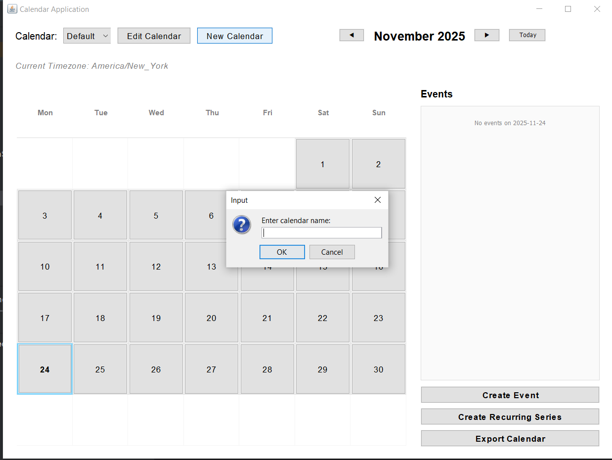
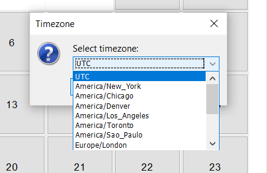
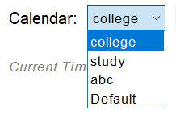
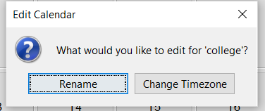
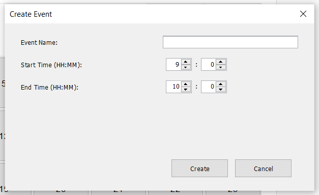
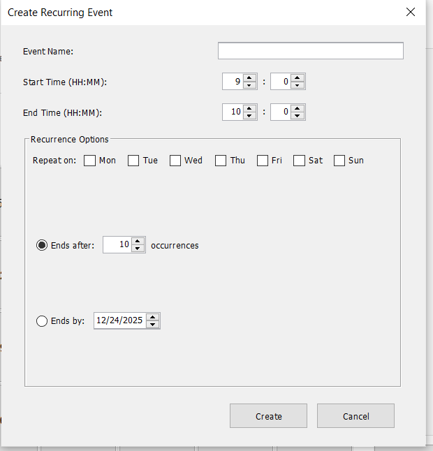
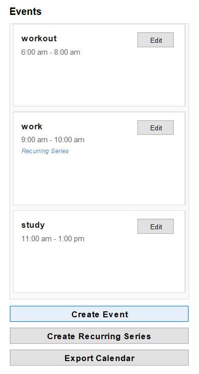
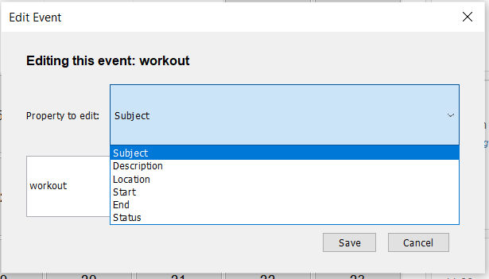
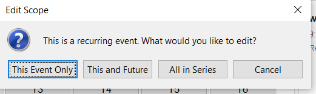
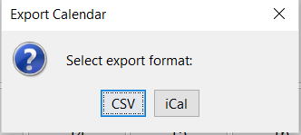

# Calendar Application - USEME.md

## Overview

This Calendar Application can run in two modes:

1. **Interactive mode** - Allows users to enter commands directly in the console.
2. **Headless mode** - Reads commands from a text file and executes them automatically.
3. **GUI mode** - Allows user to interact with a graphical user interface based on Java swing. User can perform calendar operations using the visual interface.

---

## Building the Application

To build the JAR file, run the following command from the project root directory:
```bash
./gradlew jar
```

This will create the JAR file in the `build/libs` directory.

**Example output location:**
```
build/libs/calendar-1.0.jar
```

---

## Running the Application

You can run the application using the `java -jar` command.

### 1. Interactive Mode

In this mode, the application waits for user input via the console.
```bash
java -jar build/libs/calendar-1.0.jar --mode interactive
```

You can then type commands such as:
```
create event Meeting from 2025-10-31T10:00 to 2025-10-31T11:00
print events on 2025-10-31
exit
```

---

### 2. Headless Mode

In this mode, the application reads commands from a file (e.g., `commands.txt`) and executes them without user interaction.
```bash
java -jar build/libs/calendar-1.0.jar --mode headless commands.txt
```

**Example `commands.txt`:**
```
create event Meeting from 2025-10-31T10:00 to 2025-10-31T11:00
create event Lunch from 2025-10-31T13:00 to 2025-10-31T14:00
print events on 2025-10-31
exit
```

### 3. GUI Mode

In this mode, the application launches a Java Swing GUI which the user can interact with using buttons and text fields visually. It launches when no arguments are given.
```bash
java -jar build/libs/calendar-1.0.jar
```

---

## Notes

- The `--mode` argument is **case-insensitive**, so `--mode Interactive` or `--mode HEADLESS` will both work
- Ensure your command file (for headless mode) is in the same directory where you are running the program, or provide the relative or absolute path
- The last command in headless mode **must be `exit`**

---

## Example Commands Summary

| Mode        | Example Command                                                    |
|-------------|-------------------------------------------------------------------|
| Interactive | `java -jar build/libs/calendar-1.0.jar --mode interactive`        |
| Headless    | `java -jar build/libs/calendar-1.0.jar --mode headless commands.txt` |

---


---

## Example Session

### Interactive Mode Session
```
$ java -jar build/libs/calendar-1.0.jar --mode interactive
Welcome to Calendar Application!
Type 'exit' to quit.

> create event Meeting from 2025-10-31T10:00 to 2025-10-31T11:00
✓ Event created successfully

> create event Lunch from 2025-10-31T13:00 to 2025-10-31T14:00
✓ Event created successfully

> print events on 2025-10-31
Events on 2025-10-31:
  • Meeting: 10:00 - 11:00
  • Lunch: 13:00 - 14:00

> export cal calendar.csv
✓ Calendar exported successfully
File saved at: /absolute/path/to/calendar.csv

> exit
Goodbye!
```

### Headless Mode Session

**commands.txt:**
```
create event Meeting from 2025-10-31T10:00 to 2025-10-31T11:00
create event Lunch from 2025-10-31T13:00 to 2025-10-31T14:00
print events on 2025-10-31
export cal calendar.csv
exit
```

**Run:**
```bash
$ java -jar build/libs/calendar-1.0.jar --mode headless commands.txt
Event created successfully
Event created successfully
Events on 2025-10-31:
  • Meeting: 10:00 - 11:00
  • Lunch: 13:00 - 14:00
Calendar exported successfully
File saved at: /absolute/path/to/calendar.csv
```


## GUI User Guide

### Calendar Management
* **Create a New Calendar**: Click the **New Calendar** button in the top-left toolbar. Enter a unique name and select a timezone from the provided list.


* **Switch Calendars**: Use the **Calendar** dropdown menu in the top-left to toggle between different calendars.

* 
* **Edit Calendar**: Select a calendar from the dropdown, then click the **Edit Calendar** button. You can:
    * **Rename**: Change the display name of the current calendar.
    * **Change Timezone**: Update the timezone for the entire calendar.
  

### Navigation
* **Change Month**: Click the **◀** (Previous) or **▶** (Next) arrows in the top center to navigate between months.
* **Jump to Today**: Click the **Today** button to immediately focus the view on the current system date.
* **Select a Day**: Click any cell in the calendar grid. The selected day will be highlighted in blue, and the side panel will update to show that day's events.

### Event Operations
* **Create a Single Event**:
    1.  Select a date on the grid.
    2.  Click **Create Event** on the right-hand panel.
    3.  Enter the Event Name, Start Time, and End Time.
  
* **Create a Recurring Series**:
    1.  Select the start date on the grid.
    2.  Click **Create Recurring Series** on the right-hand panel.
    3.  Check the boxes for the days of the week the event repeats (e.g., Mon, Wed).
    4.  Select an end condition: either **Ends after [X] occurrences** or **Ends by [Date]**.
  
* **View Events**: Events for the selected date are displayed in the right-hand panel, sorted chronologically from earliest to latest.

* **Edit an Event**:
    1.  Find the event card in the list.
    2.  Click the **Edit** button on the card.
  
    3.  *(For Recurring Events)* Select the scope: **This Event Only**, **This and Future**, or **All in Series**.
  
    4.  Select the property to change (e.g., Subject, Start Time, Status) and enter the new value.

### Data Export
* **Export Calendar**: Click the **Export Calendar** button at the bottom right.
    * Select **CSV** to save the current calendar as a Comma-Separated Values file.
    * Select **iCal** to save as a standard `.ics` calendar file.
  


## Design Changes Documentation
The design changes and improvements are documented in the Misc.md file
in the res folder. 

---
